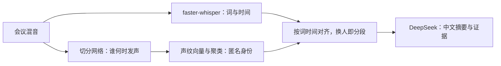

# 路线一如何区分说话人，并生成中文会议摘要

## 一句话理解

先让语音识别模型回答“说了什么”，再让说话人模型回答“谁在什么时候说”，按时间把二者对齐，最后交给DeepSeek整理中文纪要。整段录音可以只有一个混音文件，不要求为每个人分别录音。



## 使用了哪些模型

- ASR：faster-whisper small，本地CPU int8；有逐词时间戳。
- 切分：sherpa-onnx官方发布的pyannote segmentation 3.0 ONNX模型，判断局部说话活动；不是完整的pyannote Community-1管线。
- 声纹：本次英语会议采用NeMo TitaNet small ONNX提取声纹向量，再聚类合并跨片段的同一说话人。中文可配置官方提供的3D-Speaker ERes2Net模型；这不代表已完成中文效果验证。
- 摘要：使用你配置的DeepSeek API。ASR与说话人识别在本地执行，发送到文本API的是带匿名标签的转写片段；本路线不把录音发送给DeepSeek。

下载程序采用 [sherpa-onnx官方模型发布说明](https://k2-fsa.github.io/sherpa/onnx/speaker-diarization/models.html) 中的地址。Python配置方式参照 [官方示例](https://github.com/k2-fsa/sherpa-onnx/blob/master/python-api-examples/offline-speaker-diarization.py)。保留模型来源、SHA256和切分模型MIT许可证文件。不同声纹模型需遵守其自身发布许可。

## 匿名编号与人数

输出 `SPEAKER_01` 等，根据模型簇在录音中的首次出现排序。它不是真实姓名，不表示不同录音之间可以对应同一人。需要真实姓名时，应由使用者听音确认后建立映射，不能让大模型猜测。

`--num-speakers 4` 表示已知有4人，利用该录音元信息约束聚类；本次AMI实验采用此设置。仍由模型判断每个片段属于谁，没有把人工参考中的说话人标签输入识别流程。默认 `-1` 不提供人数，使用 `--cluster-threshold`（默认0.5）估计簇数量，可能把同一人拆成多人或把不同人合并。

## 避免整句话被归错人

原来只有句子级时间戳，一句话跨过换人点时无法细分。现在ASR生成词时间戳，对每个词计算与各说话人区间的时间重合比例，再组装成带身份的片段。

最强候选覆盖不足词时长的50%，或者第二候选覆盖至少25%，则标记 `speaker=null`、`speaker_uncertain=true`；其余保留最强候选。遇到换人、不确定状态变化、超过1.2秒停顿或超过20秒片段时重新分段。同一说话人重复重合的区间先取并集，避免虚增支持度。

阈值是工程启发式，并非校准概率；`speaker_time_support` 仅为时间覆盖比例，不能叫作“说话人识别置信度”。非null也不保证正确。原始模型区间和对齐后的每个词都保留，便于排查。

## 摘要约束

摘要用简体中文，保持概述、决定、行动项、风险结构，每条列表结论保留证据编号。提示词要求：匿名标签不能推断姓名；说话者不必然是任务负责人；只有明确承诺或指派才填写负责人；归属不确定的片段不能作为确定责任人的依据。

代码能检查JSON格式和引用编号存在性，不能自动保证事实正确。负责人、金额、否定、日期应对照原录音复核。没有语音分离模型时，多人同时说的内容仍可能被ASR遗漏；增加说话人模型解决的是归属问题，并不恢复已漏掉的文字。

路线一还增加最终全文复核：将候选摘要与完整精简转写一并送给文本模型，修正早期“尚未明确”但后文已明确的安排、找回跨块遗漏的会议时间，并标出金额/比例冲突。这一调用仍是机器复核。当前全文输入上限为60000字符，超出会明确报错；长会议可用 `--skip-final-review` 保留原分层摘要，再人工复核，不能静默截断后宣称看过全文。

## 运行方法

在 `meeting_summary` 目录运行：

```powershell
.\.venv\Scripts\python.exe -m pip install -r requirements.txt
.\.venv\Scripts\python.exe -m scripts.download_diarization_models
.\.venv\Scripts\python.exe run.py --route 1 --audio data/raw/ami/ES2002a/ES2002a.Mix-Headset.wav --asr-model models/weights/faster-whisper-small --language en --num-speakers 4 --out ../Route1_test_20261118/run
```

已有结果不覆盖；重复实验换新的 `--out`。中文会议还需 `python -m scripts.download_diarization_models --embedding 3dspeaker`，传入对应 `--embedding-model` 和 `--language zh`。关闭新功能用 `--no-diarization`。

如果ASR和说话人阶段已成功而API失败，可以对相同音频、相同输出目录增加 `--resume-summary`，程序校验音频SHA256并复用已保存的segments.json。先备份该目录中的失败run.json和raw_calls.json，避免丢失费用记录；恢复不会重新识别音频。当前对DeepSeek官方接口显式关闭thinking，避免推理token耗尽输出预算而没有JSON正文。

本次读取用户已填写的 `.env.example` 并复制为本机 `.env`，程序从 `.env` 加载。日志、摘要或文档不会输出密钥；由于原 `.env.example` 也包含密钥，分享项目时两者都应排除，另保留空密钥示例。

## 结果文件

| 文件 | 用途 |
|---|---|
| `asr_segments.json` / `asr_words.json` | 原始识别文字与时间 |
| `diarization.json` | 模型说话人活动区间，允许时间重叠 |
| `speaker_words.json` | 每个词的匿名身份、候选列表和未知标记 |
| `segments.json` | 换人后重组、实际送给大模型的证据片段 |
| `summary.json` / `summary.md` | 最终中文摘要和证据索引 |
| `speech_run.json` / `run.json` | 模型、哈希、已知人数、耗时和运行状态 |
| `raw_calls.json` | 实际回复、请求ID、服务端模型名和token用量，不含密钥 |

新增测试覆盖换人分段、同时说话、无覆盖、重复计数和长停顿，运行 `python -m unittest discover -s tests -v`。旧基线测试保留在 `ASR_tests_20261118`，本次完整流程另存，避免混写。
